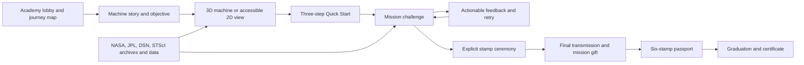

# Mission Alive

> Six machines. Six missions. One journey outward.

Mission Alive is an interactive space academy for learners aged 10 to 14. Apollo 17's lunar rover, Surveyor 3, Curiosity, Ingenuity, Webb, and Voyager 1 become teachers through story, simulation, real mission media, and six hands-on challenges.

The machines cannot come home, so they teach where they rest.

[Read the problem and solution](docs/PROBLEM_SOLUTION.md) | [Open the v1.0 release](https://github.com/hehehehehee-dev/mission-alive/releases/tag/v1.0.0) | [For AI collaborators](CLAUDE.md)

## Start here

```sh
git clone https://github.com/hehehehehee-dev/mission-alive.git
cd mission-alive
npm install
npm run dev
```

Open the local URL printed by Vite. Node.js 20.19+ or 22.12+ is recommended.

No account, API key, microphone, or 3D-capable device is required for the core academy. Sound begins off. Every required interaction has a keyboard path or an accessible alternative.

## The journey

| Mission | What the learner does | What stays with them |
| --- | --- | --- |
| Apollo 17 LRV | Build and dust-test a replacement fender | Constraints can turn ordinary materials into engineering tools. |
| Surveyor 3 | Probe, dig, compare evidence, and test a landing | Measure the ground before trusting it. |
| Curiosity | Program a science route or drive the rover freely | Habitability evidence is not proof of life. |
| Ingenuity | Choose terrain, establish a link, balance power, and fly | Engineering advances through testing and revision. |
| Webb | Unfold mirror wings, align images, and reveal infrared | Precision and launch constraints shape discovery. |
| Voyager 1 | Hear or read a Golden Record greeting, then answer it | Distance can grow while a human message keeps travelling. |

Each mission opens with a short story and a visual three-step Quick Start. The learner takes control, receives a practical correction after failure, and presses the stamp only after completing the challenge. Six stamps open the graduation finale and a printable certificate.

## A 90-second tour

1. Begin in the lobby. Follow the journey from Earth to the Moon, Mars, Sun-Earth L2, and interstellar space.
2. Open Curiosity. Build a command sequence, watch the rover execute it, then decide what the collected evidence can support.
3. Visit Ingenuity. Compare a safe plain with a crater rim or rock field and see why a stable flight can still end in a failed landing.
4. Open Webb. Pull out both mirror wings, bring three star images into focus, and move toward infrared.
5. Finish with Voyager. Play or read one of 55 greetings, write a reply, and watch the distance counter advance in whole kilometres.
6. Open the passport to show the connected certification journey, final transmissions, and graduation certificate.

For a classroom walkthrough, see [the demo guide](docs/demo.md) and the built-in **For Teachers** page.

## How it works



The browser owns the learning loop. Mission state, simulation feedback, accessibility preferences, and certification work locally after assets load. Three.js renders the machine scenes, while the same controls continue to produce textual feedback if WebGL is unavailable or the learner chooses 2D.

Live data is treated as an enhancement, not a requirement. Netlify functions cache JPL Horizons and Deep Space Network responses so the browser never pretends that stale or missing data is live. Voyager's counter is an ephemeris estimate rather than direct spacecraft telemetry.

## What makes the science feel alive

- Official NASA, JPL, ESA, CSA, and STScI media appear with visible credit and a public source record.
- Voyager includes 55 Golden Record greetings with NASA's published English meanings.
- Ingenuity's comparison uses NASA's complete 72-flight log.
- Webb's alignment sequence uses real commissioning and science imagery.
- Curiosity separates evidence of an ancient habitable environment from evidence of life.
- Deep Space Network status appears only when fresh data supports an active contact.

Every external image, recording, video, dataset, API, and factual source is catalogued in [`src/resource-credits.js`](src/resource-credits.js). The generated public reference list lives in [`docs/project-submission-references.md`](docs/project-submission-references.md).

## Built for more than one way of learning

Mission Alive supports:

- keyboard, pointer, and touch input;
- reduced motion and a manual 2D view;
- sound-off completion and written alternatives to audio;
- microphone-free Voyager completion;
- visible focus, large targets, text status, and non-color cues;
- English, Spanish, and Vietnamese interfaces;
- printable classroom resources and a teacher guide;
- local progress without a required account.

The World Health Organization estimates that 1.3 billion people, about 16 percent of the global population, experience significant disability. Accessibility is therefore part of the mission design, not a final checklist. [Read the WHO source](https://www.who.int/en/news-room/fact-sheets/detail/disability-and-health), then see the implementation notes in [`docs/ACCESSIBILITY.md`](docs/ACCESSIBILITY.md).

## Project map

```text
src/main.js                         App coordinator, mission state, routes, finale
src/certification.js                Six-mission registry and completion rules
src/scene.js                        Lazy Three.js scenes and machine anatomy
src/quick-start.js                  Shared visual onboarding
src/stamp-ceremony.js               Cancellation-safe stamp settlement
src/moon-lrv-game.js                Apollo 17 fender teaching model
src/moon-surveyor-game.js           Surveyor 3 soil teaching model
src/voyager-distance.js             Horizons-based distance display
src/dsn-widget.js                   Fresh-contact DSN presentation
src/resource-credits.js             Public source and media catalogue
src/locales/                        Spanish and Vietnamese interface copy
netlify/functions/                  Hosted live-data and classroom endpoints
tests/                              Behavior, content, data, and accessibility gates
```

The full technical handoff is in [`docs/AI_HANDOFF.md`](docs/AI_HANDOFF.md).

## Verification

```sh
npm test
npm run build
```

The v1.0 gate contains 111 automated tests. They cover certification restoration, stamp cancellation, localization purity, Golden Record assets, NASA source records, DSN freshness, Voyager distance behavior, Webb imagery, Moon simulation rules, machine audio, accessibility controls, and all six Quick Starts.

Before a release, also complete a clean six-mission browser run and check keyboard use, reduced motion, all three languages, stale-data states, and a viewport near 390 px.

## Netlify

For a source package with safe Linux file permissions:

```sh
python scripts/package-netlify.py
```

The script retains only the current and previous distinct Netlify ZIPs. A source deployment enables the bundled Netlify functions; uploading only `dist` leaves the academy playable but removes live backend enhancements. See [`NETLIFY_DEPLOY.md`](NETLIFY_DEPLOY.md) for the full deployment path.

## Privacy and optional services

The core academy uses no analytics and requires no account. Personal greetings remain on the device unless the visitor explicitly chooses a configured sharing flow. Classroom or public recordings require consent and moderation. Server secrets must never use a `VITE_` variable.

See [`docs/COMMUNITY_RECORDINGS.md`](docs/COMMUNITY_RECORDINGS.md) and [`docs/CLASSROOM_RECORDS.md`](docs/CLASSROOM_RECORDS.md) before enabling shared recordings.

## Project notes

- Mission Alive is an independent educational project and does not imply NASA endorsement.
- Mission simulations are simplified teaching models. They are labelled separately from NASA measurements and telemetry.
- The NASA logo is not used as product branding.
- External media remains credited to its listed creator or organization.
- AI-assisted development and supplied synthetic narration are disclosed in [`AI_USE.md`](AI_USE.md).

## Documentation

- [Problem and solution](docs/PROBLEM_SOLUTION.md)
- [Accessibility](docs/ACCESSIBILITY.md)
- [Assets and media provenance](docs/ASSETS.md)
- [Moon labs](docs/MOON-LABS.md)
- [Machine voices](docs/MACHINE_VOICES.md)
- [Classroom guide](docs/classroom.md)
- [Verification notes](docs/verification.md)
- [AI collaborator handoff (Claude and Codex)](docs/AI_HANDOFF.md)

Mission Alive does not ask children only to remember what these machines accomplished. It gives them a smaller version of the problem that made each accomplishment matter.
